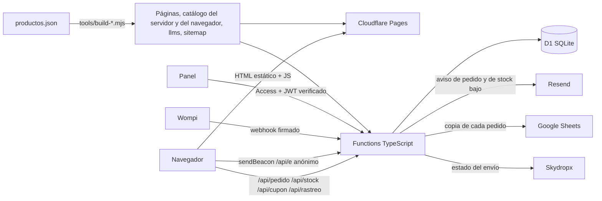

# REVTILE

Tienda en línea de suplementos deportivos para Colombia, construida de punta a punta: catálogo, canasta,
pagos, logística y una **plataforma de datos y operación** para decidir con números. Corre sin servidores
propios sobre Cloudflare Pages + Functions + D1.

> Repositorio privado. El sitio público es [revtile.com.co](https://revtile.com.co).

## Qué hay aquí

| Capa | Qué hace |
|---|---|
| **Tienda** | Catálogo de 7 productos con filtros, fichas con datos de etiqueta, canasta compartida entre páginas, pedido con mapa, combo y cupones. Minimalista, sin frameworks. |
| **Pagos y logística** | Wompi (tarjeta, PSE, Nequi) con webhook firmado, Bre-B, contraentrega, rastreo público con Skydropx. |
| **Datos** | Eventos anónimos → embudo de conversión; historial de estados → tiempos de entrega; costos → margen real; ventas → ritmo de venta y reposición; clientes → segmentos y recompra. |
| **Centro de mando** | Panel privado con pedidos, cupones, analítica, inventario, clientes y salud del sistema. |
| **Visibilidad** | Datos estructurados (JSON-LD), `llms.txt` / `llms-full.txt`, guía de elección, sitemap y robots pensados para buscadores y asistentes de IA. |

## Arquitectura



**Una sola fuente de verdad.** `productos.json` genera las fichas, la portada, `llms.txt`, el sitemap, el
catálogo que usa el navegador y el que usa el servidor. `node tools/check.mjs` falla si algo se contradice
(precios, enlaces, datos estructurados, textos prohibidos).

## Decisiones de diseño que importan

- **El servidor no confía en el navegador.** Cada pedido se recalcula en `functions/api/pedido.ts` con el
  catálogo del servidor (precios, combo, cupón, total). Si el total no coincide, se rechaza. Wompi cobra lo
  que está en la base, nunca lo que dice el cliente.
- **Stock atómico.** La venta de la última unidad se decide dentro del mismo `INSERT … SELECT … WHERE` de D1,
  así dos compradores simultáneos no pueden llevársela los dos.
- **Datos personales mínimos.** Las métricas son anónimas (sin IP, sin agente de usuario; sesión al azar que
  muere con la pestaña; respeta Do Not Track). El aviso de recompra es opt-in. El panel está detrás de
  Cloudflare Access y verifica la firma del token (`CF_ACCESS_*`).
- **Funciones puras separadas de la base de datos.** Pronóstico, reposición, embudo, margen, segmentación y
  recompra viven en `functions/api/_ops/calculos.ts`, sin E/S, y tienen pruebas unitarias.
- **Tolerancia a migraciones pendientes.** Si la base va por detrás del código, el pedido se guarda igual
  (menos columnas) y el panel avisa qué migración falta. Nunca se pierde una venta.

## Plataforma de datos

| Pregunta | Dónde sale |
|---|---|
| ¿Cuánta gente se pierde en cada paso? | `eventos` → embudo (sesiones distintas) |
| ¿Qué producto convierte mejor? | `eventos` (vieron vs. añadieron) |
| ¿Cuánto me queda de cada producto y cuándo debo reponer? | ventas de 60 días → suavizado exponencial → días de stock → unidades a pedir según el tiempo del proveedor |
| ¿Cuánto gano de verdad? | `costos` × ventas, antes de combos y cupones |
| ¿Cuánto tardo en despachar y entregar? | `estados_log` |
| ¿A quién le escribo para que recompre? | `pedidos.recordar` + duración del producto → fecha de aviso, con mensaje listo |
| ¿Quién vale más y quién se está enfriando? | RFM simplificado → nuevo / recurrente / VIP / en riesgo / dormido |

## Cómo se trabaja

```bash
npm install
npm run construir    # regenera páginas y catálogos desde productos.json
npm run verificar    # coherencia de precios, enlaces y textos
npm run tipos        # TypeScript estricto
npm run test:unidad  # funciones puras
npm run test:integracion   # sitio completo con D1 local (Wrangler)
npm test             # tipos + unidad + integración
npm run demo         # tienda y panel con DATOS SINTÉTICOS en http://localhost:8788 (llave: demo)
```

`.github/workflows/ci.yml` corre lo mismo en cada push. Las pruebas de integración levantan el sitio con
Wrangler, aplican las migraciones de `db/` en orden y llaman a la API como un cliente real: precios y stock,
trampas (total falso, producto inventado, `__proto__`, cuerpo que no es JSON), combo y cupones, webhook de
Wompi, eventos, y cada pestaña del panel.

## Base de datos

Migraciones en orden: `db/schema.sql`, `schema-v2.sql` (cupones), `schema-v4.sql` (archivo de pedidos),
`schema-v6.sql` (plataforma de datos). Se ejecutan en D1 → Console. Ver `SETUP-CLOUDFLARE.md`.

## Estructura

```
productos.json            catálogo y textos (fuente única)
tools/                    generadores y verificador (Node, sin dependencias)
functions/api/            Functions en TypeScript (pedido, stock, cupon, rastreo, wompi, admin, e)
functions/api/_ops/       cálculos puros, consultas del panel, envíos, registro de errores
db/                       migraciones SQL
js/ css/ *.html           sitio público y Centro de mando
tests/                    unidad e integración
```

## Pendiente / siguiente

- Mensajes automáticos de WhatsApp (requiere WhatsApp Business API de Meta; hoy el panel deja el mensaje
  listo y se envía con un toque).
- Webhook de Skydropx en lugar del botón «Sincronizar» (hoy se sincroniza al consultar el rastreo o desde el panel).
- Cron de alertas (Pages no tiene tareas programadas; el aviso de stock bajo se dispara con la propia venta).
